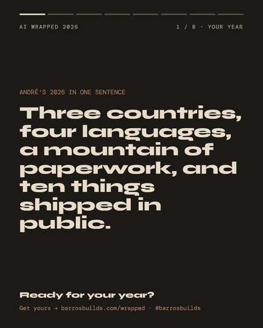

# AI Wrapped 2026

**Your year with Claude, as eight story cards you can share and compare.**
Private by design: your export is analysed in your own browser, and nothing is uploaded. There's no server to upload it to.

**[Get yours → barrosbuilds.com/wrapped](https://www.barrosbuilds.com/wrapped)** · [See an example](https://www.barrosbuilds.com/wrapped/story#demo) · ⭐ Star this repo to get the 2027 edition

<p align="center"></p>

## What you get

Eight cards (1080×1350, ready for LinkedIn or Instagram): your year in one sentence, the numbers, how you work, your chattiest day, your **AI club** (Researchers, Builders, Coders, Night Shift, Polyglots or Talkers), your **AI clock**, how often you made Claude try again versus said thanks, and a prediction for 2027.

Then compare: send a friend your link and see who wins each stat, or tag your team and join the **[Wall](wall/)**.

## Three ways in

| | How | Time | Numbers |
|---|---|---|---|
| **Website** | Export your data from Claude (Settings → Privacy → Export data) and drop the ZIPs on [the site](https://www.barrosbuilds.com/wrapped). | ~5 min | Exact |
| **Prompt kit** | Run [`prompts/full.md`](prompts/full.md) (with your export) or [`prompts/lite.md`](prompts/lite.md) (no export) in your own Claude account, then paste the reply at [/import](https://www.barrosbuilds.com/wrapped/import). | 30 s to 5 min | Exact or estimated |
| **Command line** | `pip install -r requirements.txt` then `python scripts/wrapped.py path/to/export Europe/Lisbon` | 1 min | Exact |

## Private by design

- **Your export never leaves your browser.** DuckDB runs inside the page (WebAssembly) and does all the counting.
- **The browser enforces it.** A Content-Security-Policy with `connect-src 'self'` means the page can't send data to any other site, whatever the code does.
- **Only what the stats need is opened.** `light_metadata` (your email, phone and login IPs), memories and artifact contents are never opened, even if you drop them. Tests check this.
- **Chat titles and your own words never leave the device**, not even in share links. Shared stats use an explicit allow-list.
- **Share links carry your stats after the `#`**, which browsers never send to a server.
- No accounts, no database, no cookies. Page views are counted anonymously by Vercel Analytics. Details: [privacy policy](https://www.barrosbuilds.com/wrapped/privacy).

## How it works

```
export ZIPs ─► JSZip (Web Worker) ─► DuckDB-WASM: chats, messages, blocks
                                        │  sql/metrics/*.sql  (the same files the CLI runs)
                                        ▼
                                  your stats ─► 8 cards (SVG/HTML) ─► PNG, made in the browser
                                        │                  └─► share and compare links (#fragment)
                                        └─► (opt-in) a GitHub pull request ─► the Wall + open dataset
```

- **Every metric is plain SQL** in [`sql/`](sql/), with a header saying what it measures. The site and the CLI run the same files, and each card has a "Show the query" button.
- **The numbers are tested for exactness.** The browser, the CLI and the prompt kit produce identical results on synthetic exports in five timezones, including year boundaries, daylight saving, emoji, edits and regenerations.
- Static site (Next.js, `output: "export"`). No backend, nothing to patch or scale.

## The Wall and the open dataset

Opt in from your story and the site prepares a GitHub pull request with your numbers, a display name and an optional group tag (your team, company or city). An Action validates it, and after merging, DuckDB rebuilds the leaderboards and [`data/wall.parquet`](data/), which anyone can query:

```sql
SELECT club, count(*) AS people, median(chats) AS median_chats
FROM 'https://github.com/andrebarros6/ai-wrapped/raw/main/data/wall.parquet'
GROUP BY club ORDER BY people DESC;
```

How to join, the rules and how to leave: [`wall/README.md`](wall/README.md).

## Contribute

The first good issue is a **ChatGPT loader**, so ChatGPT users get their cards too. See [CONTRIBUTING.md](CONTRIBUTING.md).

```
npm ci && npm run dev              # http://localhost:3000/wrapped
npm run build && npm run test:e2e  # browser tests against the static build
python -m venv .venv && .venv/Scripts/pip install -r requirements-dev.txt && pytest
```

## Repo map

- [`sql/`](sql/): every metric, the single source of truth for site, CLI and tests
- [`scripts/wrapped.py`](scripts/wrapped.py): the CLI · [`scripts/prompt_kit.py`](scripts/prompt_kit.py): what the prompt kit runs
- [`app/`](app/), [`components/`](components/), [`lib/`](lib/): the static site and its in-browser engine
- [`wall/`](wall/), [`data/`](data/): the Wall's entries, rules and open dataset
- [`fixtures/`](fixtures/): synthetic exports and expected results for tests
- [`docs/`](docs/): spec, export format and data model, build plan

---

MIT licence. Not affiliated with Anthropic; "Claude" is their trademark. Built by [André Barros](https://www.barrosbuilds.com) · Barros Builds 2026.
